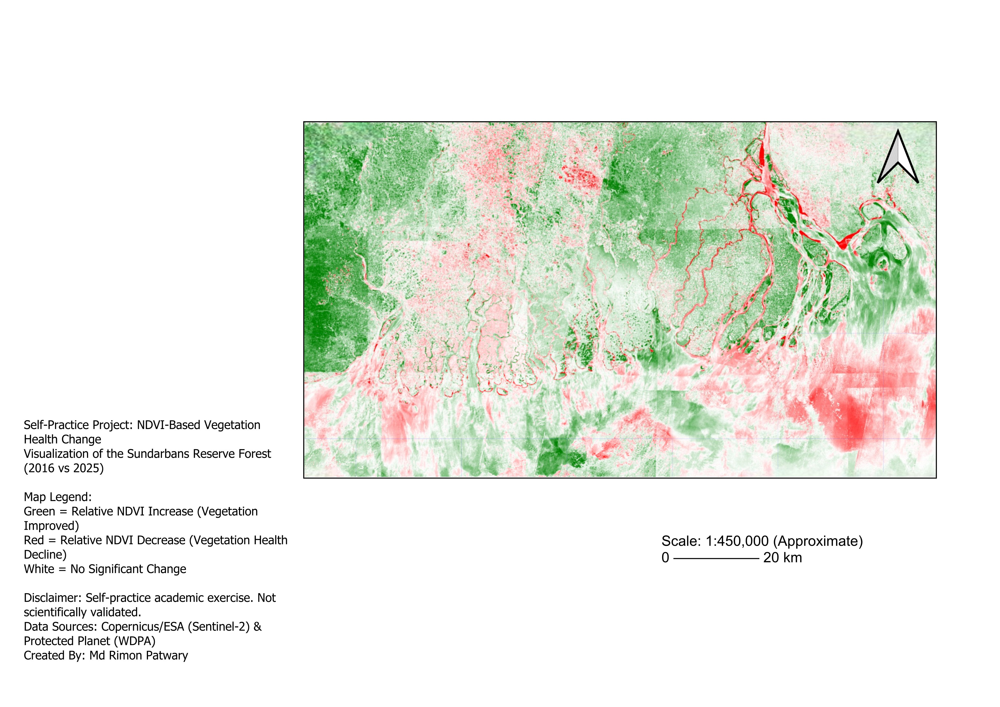

# NDVI-Based Vegetation Health Change Visualization of the Sundarbans Mangrove Forest (2016 vs 2025)

## Project Overview

This independent self-practice project focuses on visualizing the change in vegetation health within the Sundarbans Mangrove Forest, Bangladesh, between 2016 and 2025. By analyzing satellite imagery, this exercise applies Remote Sensing (RS) and Geographic Information Systems (GIS) techniques to visualize relative vegetation change. The project is inspired by the top-dying symptoms observed in *Heritiera fomes* (Sundari) trees, which appear linked to rising soil and water salinity levels.

## Key Features

- **Temporal Analysis:** Compared vegetation indices between 2016 and 2025.
- **Index Calculation:** Calculated NDVI values for 2016 and 2025 to compare vegetation health change.
- **Visual Mapping:** Generated a change map showing relative vegetation improvement, decline, and stability.

## Data Sources

- **Satellite Imagery:** Sentinel-2 imagery (Copernicus/ESA)
- **Boundary Data:** Sundarbans Boundary (Protected Planet/WDPA)

## Tools & Technologies Used

- **GIS Software:** QGIS
- **Analysis Modules:** Raster Calculator
- **Cartographic Output:** QGIS Print Layout (for map composition, legend, and scale bar)

## Map Legend & Interpretation

- **Green:** Relative NDVI Increase (Vegetation Improved)
- **Red:** Relative NDVI Decrease (Vegetation Health Decline)
- **White:** No Significant Change

## Project Output

## Technical Considerations & Limitations

- **Data Constraints:** Certain raster texture smoothing artifacts and tile-mosaic blending limits are present due to the integration of multiple raw satellite scenes. These represent standard satellite data alignment challenges openly noted for educational documentation.

## Academic Disclaimer

This is a self-practice academic exercise developed to build baseline technical competencies in vegetation change detection. It is not a peer-reviewed or scientifically validated ecological study.

---

**Author:** Md Rimon Patwary  
*Botany graduate. Holds an offer for the Master of Applied Science (Biodiversity Management) at Unitec Institute of Technology, New Zealand.*
