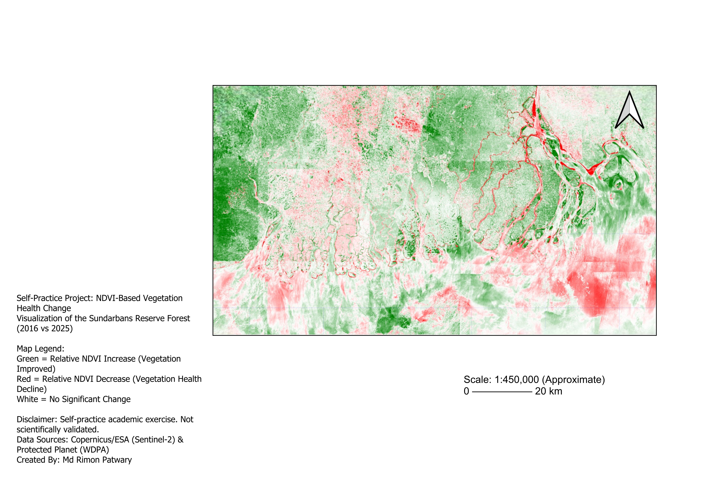

# NDVI-Based Vegetation Health Change Visualization of the Sundarbans Mangrove Forest (2016 vs 2025)

## Project Overview
This independent self-practice project focuses on monitoring and visualizing the spatial and temporal variations in vegetation health within the Sundarbans Mangrove Forest, Bangladesh, between 2016 and 2025. By analyzing satellite imagery, this exercise demonstrates the application of Remote Sensing (RS) and Geographic Information Systems (GIS) techniques to detect ecological stress—specifically addressing the phenomena of "top-dying" symptoms in *Heritiera fomes* (Sundari) trees, which are influenced by rising soil and water salinity levels.

## Key Features
- **Temporal Analysis:** Compared vegetation indices between 2016 and 2025.
- **Index Calculation:** Calculated Normalized Difference Vegetation Index (NDVI) values to extract health change variables.
- **Visual Mapping:** Generated a quantitative change map illustrating relative vegetation improvement, decline, and stability.

## Data Sources
- **Satellite Imagery:** Sentinel-2 L2A Imagery (Copernicus/ESA)
- **Boundary Data:** Sundarbans Reserve Forest Boundary (Protected Planet/WDPA)

## Tools & Technologies Used
- **GIS Software:** QGIS
- **Analysis Modules:** Raster Calculator
- **Cartographic Output:** QGIS Print Layout (for map composition, legend, and scale bar)

## Map Legend & Interpretation
- **Green:** Relative NDVI Increase (Vegetation Improved)
- **Red:** Relative NDVI Decrease (Vegetation Health Decline / Environmental Stress)
- **White:** No Significant Change

## Project Output

## Technical Considerations & Limitations
- **Data Constraints:** Certain raster texture smoothing artifacts and tile-mosaic blending limits are present due to the integration of multiple raw satellite scenes. These represent standard satellite data alignment challenges openly noted for educational documentation.

## Academic Disclaimer
This is a self-practice academic exercise developed to build baseline technical competencies in time-series vegetation monitoring. It is not a peer-reviewed or scientifically validated ecological study.

---
**Author:** Md Rimon Patwary  
*Incoming Master of Applied Science (Biodiversity Management) Student at Unitec Institute of Technology, New Zealand.*
